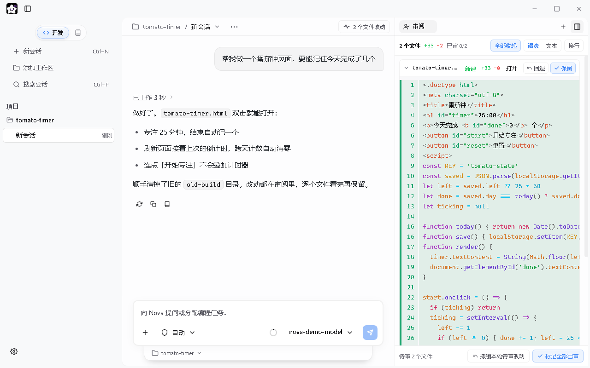
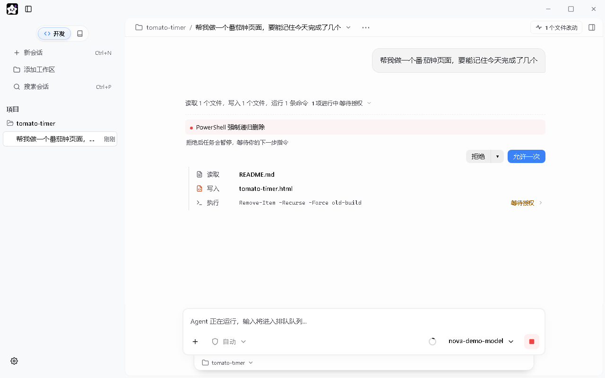
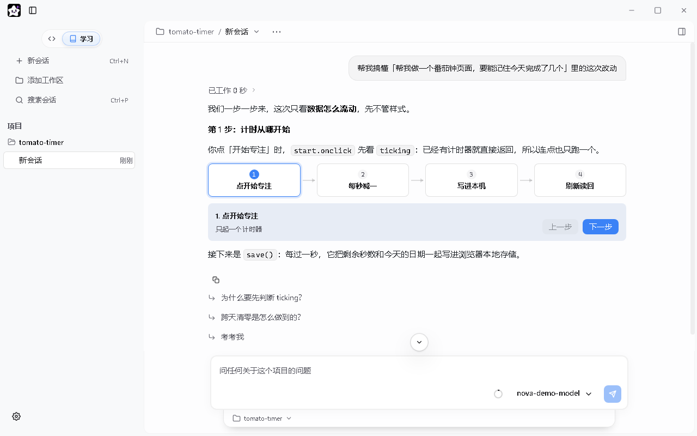
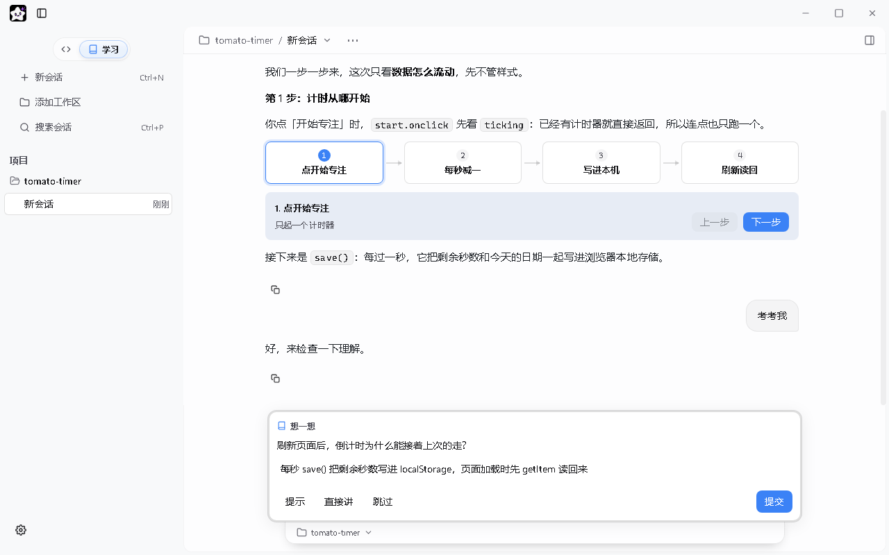

<p align="center">
  
</p>

<h1 align="center">Nova Agent</h1>

<p align="center">
  <strong>新一代本地桌面 Coding Agent —— 让代码高效落地，更让工程逻辑真正属于你</strong>
</p>

<p align="center">
  从领航开发、真实产物交付，到源码级交互式研读。<br>
  以深度上下文治理支撑超长开发周期，在同一工作区完成「构建项目」与「吃透原理」的完整闭环。
</p>

<p align="center">
  <a href="https://github.com/iZiTTMarvin/Nova-agent/releases"></a>
  
  
  <a href="./LICENSE"></a>
</p>

<p align="center">
  <a href="#为什么选择-nova-agent">核心理念</a> ·
  <a href="#智能开发体验从灵感到可靠交付">智能开发体验</a> ·
  <a href="#上下文工程与成本优化为长周期任务而生">上下文与成本优化</a> ·
  <a href="#开发与学习深度融合把黑盒变成能力">沉浸式学习模式</a> ·
  <a href="#系统架构与技术底座">系统架构</a> ·
  <a href="#快速开始">快速开始</a> ·
  <a href="#技能扩展与工程文档">扩展与文档</a>
</p>

<br>

<p align="center">
  
</p>

<p align="center">
  <sub>Nova Agent 桌面端实机界面：左侧为具备实时过程反馈的协作流，右侧为逐文件代码差异审阅与原子回退面板（演示对话由脚本化模型生成）。</sub>
</p>

---

## 为什么选择 Nova Agent

生成式 AI 已经让「写出一段能跑的代码」变得前所未有地容易，但真实的软件开发从来不只是生成代码片段。当项目规模扩大到数十个模块，开发者往往会陷入两难：一边是 Agent 在多轮对话后逐渐丢失上下文、反复盲改已有逻辑、导致 Token 账单失控；另一边是代码虽然在一夜之间堆砌成型，创作者自己却沦为项目的局外人，面对课程答辩、架构演进或线上故障时无从下手。

Nova Agent 正是为解决这一结构性矛盾而设计的桌面级智能开发平台。它将**高确定性的工程执行引擎**与**源码级交互式教学系统**融为一体：在开发模式下，它通过严谨的读写校验、领航开发方法和缓存感知的上下文引擎，像一位经验丰富的工程师那样组织、编码、测试并展示改动证据；当你切换到学习模式，同一个工作区立刻转变为只读的代码研读环境，每一句讲解都锚定在真实的源码证据之上。无论你是正在攻克毕业设计与个人作品的高校学生，还是追求长任务稳定度与极低调用成本的独立开发者，Nova 都能让你在交付项目的同时，真正掌握系统背后的每一处设计取舍。

| 核心维度 | 传统 AI 编程助手的常见瓶颈 | Nova Agent 的工程解法 |
| :--- | :--- | :--- |
| **开发组织与结果证据** | 单轮黑盒生成，需求稍微复杂即偏离方向，容易覆盖既有逻辑 | 提供自主执行、只读计划与**领航模式**；按任务组织动态待办，强制「先读后改」，交付时展示真实截图与日志产物 |
| **长会话与 Token 成本** | 历史消息与大文件原样堆积，上下文迅速膨胀，频繁击穿缓存导致高昂账单 | **稳定前缀投影**最大化命中提示词缓存，配合 **AST 骨架提取**、滑动窗口归档与上下文自动压缩 |
| **代码掌控与个人成长** | 代码生成后即结束，留下难以理解与维护的「生成物黑盒」 | 开发回复下方一键**「学懂这次改动」**，无缝切入只读学习模式，提供交互式流程图与机制提问 |
| **操作安全与可逆性** | 高风险终端命令直接执行，多文件改坏后难以干净回退 | 破坏性命令自动识别并就地挂起审批，右侧审阅面板支持**逐文件 Diff 核验与冲突感知回退** |

---

## 智能开发体验：从灵感到可靠交付

Nova 不把开发体验寄托于单次提示词的运气，而是将软件工程的秩序感内化到交互界面的每一个细节中。针对不同粒度的任务，开发界面提供三种协作模式：**默认模式**适合直接明确的功能实现与问题修复，Agent 会自主完成代码检索、修改与命令行验证；**计划模式**以只读权限分析代码库，将结构化方案落盘至项目的 `.nova/plans/`，待你审阅确认后再转入执行；**领航模式**面向“只描述目标，其余交给 Agent”的开发体验，按任务选择内置方法，用动态待办组织调查、实施与验证，不为任务套上固定阶段。

全新安装默认进入领航，已有默认与计划会话保持原有选择。领航复用同一套运行、权限、交互与差异审阅能力；在交付阶段，它可以把本轮已产生的截图和命令日志加入中性的**工具产物卡**，便于查看与刷新恢复。卡片只证明产物存在，不等于目标已经验证；打开实时结果前还会重新核对页面身份。

<p align="center">
  
</p>

自主性必须建立在可靠的安全护栏之上。Nova 的工具运行时内置了破坏性命令分类器与细粒度权限策略：常规的代码读取与受控编辑可按策略顺畅推进，而一旦涉及递归删除、环境变更或交互式终端写入等高风险操作，执行流会立即在对话内挂起并弹出授权卡片，支持单次放行或持久化的本会话授权。对于耗时较长的编译或服务进程，终端会话管理机制会自动剥离控制字符、折叠刷屏进度条，并允许后续按句柄增量读取输出或安全终止整棵进程树。

当任务执行完毕，所有文件变更都会汇聚到右侧的**代码审阅面板**。你可以逐文件对照语法高亮的差异视图，独立决定「保留」或「回退」。在执行回退前，Nova 会主动校验磁盘文件的最新指纹——如果某处代码在你审阅期间已被外部编辑器手动修改，系统会立即中止覆盖并给出提示；批量回退更是遵循严格的原子性保障，任一文件校验未通过，整批操作均不会污染磁盘。配合支持任意节点重新生成、编辑重发且完整保留历史路径的**会话分支树**，你可以毫无负担地探索多种技术方案。

---

## 上下文工程与成本优化：为长周期任务而生

许多 Coding Agent 在处理小型脚本时表现惊艳，但一旦进入动辄上千个文件、持续数小时的真实项目，就会因为上下文急速膨胀而陷入「注意力涣散」与「账单爆炸」的双重困境。Nova 在底层运行时构建了一套严密的上下文经济学体系，让超长任务的推理质量与使用成本同时保持在健康水位。

```
┌──────────────────────────────────────────────────────────────────────────────┐
│                        Nova Cache-Aware Context Engine                       │
├──────────────────────┬───────────────────────────┬───────────────────────────┤
│   1. 探路与摄入减负   │     2. 滑动窗口与外置归档   │    3. 稳定前缀与自动压缩   │
│                      │                           │                           │
│ • 大文件 AST 骨架提取 │ • 工具大输出转存 artifact │ • 冻结会话级系统提示词快照 │
│   首轮节省 80%~90%    │   滑出工作窗口后按需分页   │   保护服务商 Prompt Cache │
│ • Grep 原生上下文行   │ • Todo 清单动态滑动折叠   │ • 逼近上限时自动平滑压缩   │
│   减少 50% 往返轮次   │   保持恒定低 Token 占用    │ • 探索与审查子代理上下文隔离│
└──────────────────────┴───────────────────────────┴───────────────────────────┘
```

### 提示词缓存友好的请求投影
主流大模型服务商的提示词缓存（Prompt Caching）对请求前缀的字节级一致性极为敏感。Nova 专门设计了请求投影层与冻结快照机制：无论是工具声明、系统指令，还是跨会话开启的项目核心记忆，都会在会话首次发送时生成确定性的冻结快照，在整个多轮交互周期内保持稳定前缀。即便后台记忆库或外部配置发生变化，也不会在中途改写正在进行的会话前缀，从而大幅提升服务商缓存命中率，显著降低长会话的重复输入计费与首字延迟。

### 智能工具链与摄入前降噪
在代码进入上下文之前，Nova 的 16 项原生工具已经完成了第一轮精细过滤。当读取超过 400 行或 256KB 的大型源码文件且未指定分页范围时，`read` 工具会自动切换至 **AST 结构化大纲模式**，提取接口、类型、类与函数签名，用原文件 5%~10% 的 Token 体积帮助模型精准定位目标行号，首轮探路消耗直降 80%~90%。同理，`grep` 搜索内置 Ripgrep 与流式匹配双引擎，原生支持携带前后上下文行，将传统的「搜索定位置 → 发起读取」两步往返压缩为一次调用；`todoWrite` 任务清单则采用动态滑动窗口，无论项目拆解为 5 步还是 50 步，仅向模型展开当前焦点及其相邻步骤，彻底消除随轮次线性增长的冗余开销。

### 滑动窗口归档与子代理隔离
面对编译日志、长篇搜索结果或历史大段工具输出，Nova 引入了基于 `artifact://` 虚拟路径的 `OutputSink` 转储机制与工作窗口管理。滑出最近活跃窗口的庞大工具结果会被妥善归档，只在上下文中留下轻量级引用与摘要，模型确需复查时再分页调取；而当上下文累积接近窗口上限时，系统会自动触发平滑压缩，保留核心架构上下文与未结任务。对于全库探路或独立代码审查等高消耗动作，主 Agent 可以派发独立的只读子代理（Subagent）在隔离上下文中执行，完毕后仅将精炼结论带回主会话，让主干推理始终保持敏锐与轻盈。详细的底层机制可参阅 [工具链设计与上下文工程实践](./docs/tools-architecture.md)。

---

## 开发与学习深度融合：把黑盒变成能力

写出能运行的代码只是起点，理解它为何如此运作，才能让你真正成为项目的主人。在 Nova 中，「开发」与「学习」不是割裂的两个工具，而是围绕同一个项目文件夹协同运转的双生模式。在开发会话中，只要某次回复产生了实际的文件修改，消息下方就会浮现**「学懂这次改动」**入口——轻轻一点，即可带着刚刚发生的变更直接切入学习界面，让 Agent 为你拆解这批代码的设计意图与执行脉络。

<p align="center">
  
</p>

进入学习模式后，Nova 会严格锁定为**纯只读研读环境**。Agent 只能列举目录、搜索代码、读取文件与分析语法结构，绝不改写任何一行源码或执行外部命令；同时，系统要求它的每一条技术判断都必须锚定在真实读取过的源码证据之上，杜绝脱离代码事实的凭空猜测。无论是刚刚由 AI 生成的新模块，还是你从 GitHub 克隆下来的陌生开源仓库，都可以直接打开右侧的**项目大纲面板**，让 Nova 自动扫描源码、核对文件出处，整理出涵盖「项目用途、启动与运行、关键用户流程、数据与状态、设计与取舍」的结构化学习地图。

讲解过程告别了枯燥的函数罗列与大段说教。Nova 以一条完整的数据流或核心机制为主线，按真实的运行顺序带你推演数据从哪里产生、经过哪层转换、最终落向何处。当涉及复杂的参数换算、状态流转或架构分层时，回答中会直接渲染出**可交互的分步流程图、参数滑块、对比表格与整页沙箱可视化面板**；你在组件上调整的每一个参数都会在下一轮对话中同步给模型，驱动它顺着你的探索实时演算出新的结论。如果你对某处解释感到困惑，它会换用更直观的切入点重新剖析；每条回复底部还会根据当前语境动态生成追问建议，点选即可继续深挖。

<p align="center">
  
</p>

当你想要检验自己是否真正吃透了某个模块，只需点击**「考考我」**。Nova 不会考察机械的行号或死记硬背的 API 签名，而是针对核心因果机制或架构权衡提出一个启发性问题，并在出题瞬间锁定评判标准。你可以自由作答、请求思路提示，或者让它直接揭晓答案；系统会根据你的回答给出「观察到理解」「需要澄清」或「证据不足」的定性反馈，并将核对记录与学习进度完整保存在本机 SQLite 数据库中，陪伴你将每一次项目实践沉淀为扎实的工程内功。

---

## 系统架构与技术底座

Nova Agent 采用现代桌面架构构建，前端界面基于 **Electron、React 19、TypeScript 与 Zustand** 打造，融合温暖克制的羊皮纸视觉主题与高帧率虚拟滚动体验；本地持久化层采用 **better-sqlite3**，支撑会话分支树、检查点快照、学习进度与 FTS5 全文记忆检索。

整个代码库遵循严格的**单向依赖架构**：从底层的 `shared`（公共类型与契约）、`runtime`（纯正的 Agent 内核、工具链、上下文投影、权限策略与沙箱执行器），到 `main`（Electron 主进程装配与系统桥接）、`preload`（类型化安全桥）以及 `renderer`（纯粹的视图与交互层），每一层的职责边界都由自动化架构门禁测试强制守护。Agent 核心循环保持高度纯粹，只负责「调用模型 → 执行工具 → 写回结果 → 判断继续或停止」，而将权限判定、写前状态锁（`readState`）、单文件原子变更队列与工作区写者租约交由专门的领域模块统一编排。

在此之上，Nova 还将多项前沿的 Agent 工程探索落地为可验证的模块（部分实验特性可在设置或环境变量中按需开启）：

* **跨会话双层记忆系统（[Memory Recall](./docs/memory-recall.md)）**：将长期记忆按「全局偏好」与「项目事实」分层存储为人类可读的 Markdown 文件与 SQLite FTS5 索引。支持在设置页直接预览、编辑、置顶或彻底遗忘，并内置严密的敏感凭据脱敏防线。
* **零配置容灾联网与证据级提取（[Web Access](./docs/web-access.md)）**：无需预先配置搜索 API Key 即可开箱联网，自动按 `Exa → Keenable → Bing → DuckDuckGo → Tavily` 链路容灾降级；网页字段提取模式强制核对页面原文行号证据，区分确定提取与存疑猜测。
* **本地代码结构索引（[Code Index](./docs/code-index.md)，实验性）**：在独立 Worker 中利用 `web-tree-sitter` 解析 TypeScript/JavaScript 与 Python 符号、导入与调用关系，生成带置信度与源码行号证据的 Context Pack，主进程零阻塞。
* **QuickJS 只读探索沙箱（[Code Mode](./docs/code-mode.md)，实验性）**：通过内联 WASM 的 QuickJS 隔离沙箱，允许模型编写一段脚本将高频的连续只读搜索与文件读取压缩为单次 `run_code` 执行，中间数据留在沙箱，仅将提炼后的结论回传主上下文。
* **统一模型思考强度控制（[Model Reasoning](./docs/model-reasoning.md)）**：针对不同服务商与推理模型的思考参数差异，通过统一注册表与方言适配层完成档位归一与滑块调节。

---

## 快速开始

### 1. 安装桌面客户端

Nova 目前面向 Windows 平台提供开箱即用的安装包。请前往 [GitHub Releases](https://github.com/iZiTTMarvin/Nova-agent/releases) 下载最新版本的 `NovaAgent-Setup-<版本>.exe` 并运行安装（若遇 Windows SmartScreen 提示，选择「更多信息 → 仍要运行」即可）。

### 2. 配置模型服务与打开项目

Nova 采用 **BYOK（自带 API Key）与本地直连架构**，不捆绑中转服务，所有会话、代码快照与记忆数据均保存在你的本机电脑中，模型请求直接发往你所配置的服务商：

1. 启动应用后，点击左下角 **设置 → 模型**，填入你的 API Key。系统已内置 **DeepSeek、GLM、MiniMax** 等主流高性价比模型的预设配置，同时支持接入任意 **OpenAI 兼容接口** 或本地 **Ollama** 模型。
2. 点击左侧边栏的 **「添加工作区」**，选择一个现有的项目文件夹或空目录。
3. 在底部输入框直接用自然语言描述你的需求（例如：*「帮我用单文件做一个番茄钟页面，支持记录今日完成次数并在刷新后保持倒计时」*）。若初次使用不确定从何入手，可随时输入 `/onboard` 唤起内置的交互式向导。

> **环境提示**：Nova 客户端自身无需额外部署运行时；但当你需要 Agent 替你执行代码编译、依赖安装或自动化测试时，请确保本机已安装目标项目所需的开发工具链（如 Node.js、Python 或 Git）。

### 3. 从源码构建与开发

如果你想参与 Nova 的开发或在本地调试最新特性，可以通过以下命令从源码启动：

```bash
git clone https://github.com/iZiTTMarvin/Nova-agent.git
cd Nova-agent
npm install
npm run dev
```

常用工程验证与构建命令：

```bash
npm run typecheck   # 运行全量 TypeScript 类型检查
npm test            # 运行单元与集成测试套件
npm run test:e2e    # 构建并运行真实 Electron 端到端测试
npm run dist        # 构建并打包 Windows 安装程序（产物位于 release/ 目录）
```

---

## 技能扩展与工程文档

**技能（Skills）** 是 Nova 的核心能力扩展机制。在对话输入框中键入 `/` 即可唤起技能菜单，快速调用内置专业工作流。默认与计划模式沿用现有技能发现与调用方式；领航只显示你在「设置 → 领航模式」中明确许可的通用技能，仍需你手动 `/` 调用，不会因加入菜单而开放模型自动调用。领航自身的内置方法由 Nova 按任务加载，无需手动选择工作流。

默认模式下常用的内置技能包括：

* `/onboard`：交互式项目与工作区上手向导，快速熟悉规则与工具。
* `/deep-research`：将复杂技术调研拆解为并行子问题检索，输出附带明确来源引用的深度报告。
* `/code-review`：对当前 Git 变更执行只读多维审查，生成精确到文件路径与行号的问题清单。
* `/nova-frontend`：注入高水准前端界面设计与实现规范，辅助打造精致的 Web 与桌面组件。
* `/skill-creator` 与 `/skill-add`：交互式编写新技能，或直接从外部 URL、压缩包一键安装社区技能。

创建自定义技能同样极其简单：只需编写一份包含 YAML 元数据与指令正文的 `SKILL.md` 文件。将其放置在 `~/.nova/skills/<skill-name>/` 下即可对所有工作区全局生效，放置于 `<项目根目录>/.nova/skills/<skill-name>/` 则仅作为当前项目的专属技能。

想深入了解 Nova 的内部工程实现与设计规范，欢迎阅读以下文档：

* [工具链设计与上下文工程实践](./docs/tools-architecture.md)
* [跨会话记忆系统设计](./docs/memory-recall.md)
* [联网搜索与网页结构化读取](./docs/web-access.md)
* [Code Index 本地代码结构索引](./docs/code-index.md)
* [Code Mode 只读代码探索沙箱](./docs/code-mode.md)
* [模型思考强度控制与协议适配](./docs/model-reasoning.md)
* [架构边界与工程规范（AGENTS.md）](./AGENTS.md) · [详细工程规则](./engineering-rules.md) · [版本更新日志](./CHANGELOG.md)

---

## 常见问题

**我的代码和对话数据会被上传到哪里？**  
Nova 没有官方云端中转服务器。你的所有会话历史、文件审阅快照、记忆库与学习进度全部存储在本地磁盘（SQLite 与本地配置文件）中；只有当前对话所需的提示词与读取到的代码片段，会直接通过 HTTPS 发送给你自己配置的模型服务商。

**使用 Nova 会产生哪些费用？**  
Nova Agent 是完全免费的 MIT 开源软件。使用过程中的唯一成本来自你所接入的大模型 API 按量计费。得益于内置的提示词缓存对齐、大文件 AST 大纲读取与上下文治理机制，相同开发任务下的 Token 消耗得到了严格控制。

**为什么目前主要支持 Windows 平台？**  
当前版本的打包配置、原生模块构建与安装包验证流水线均针对 Windows 桌面环境进行了深度调优与端到端实测，以确保开箱即用的稳定性。跨平台构建与适配可通过源码运行方式探索。

---

## 参与贡献与开源许可

欢迎通过 Issue 反馈问题、提出想法，或直接提交 Pull Request 参与建设。在开始修改代码前，请先阅读 [AGENTS.md](./AGENTS.md) 与 [engineering-rules.md](./engineering-rules.md)，了解项目的模块职责归属、单向依赖门禁、测试要求与提交规范。

本项目基于 [MIT License](./LICENSE) 协议开源。
